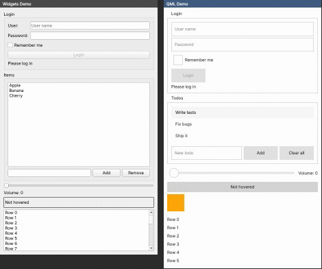
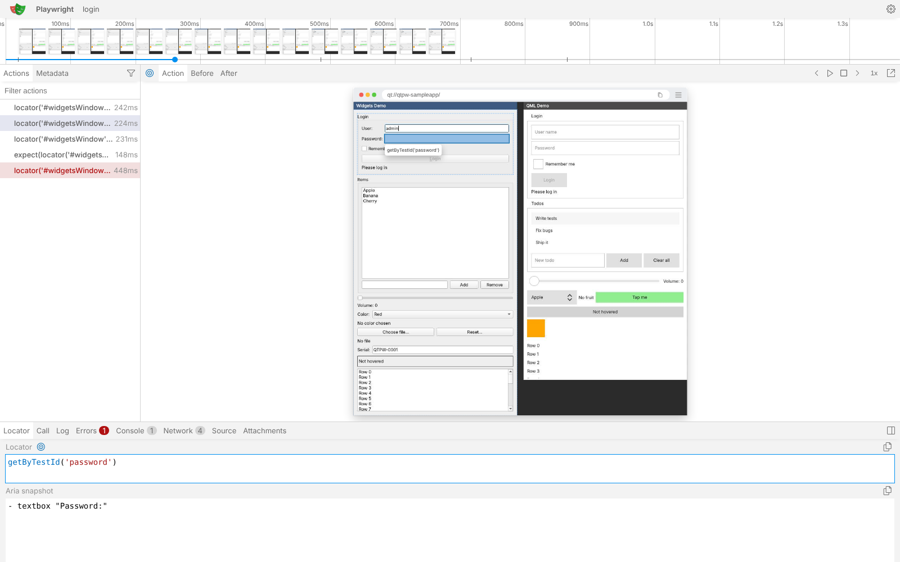
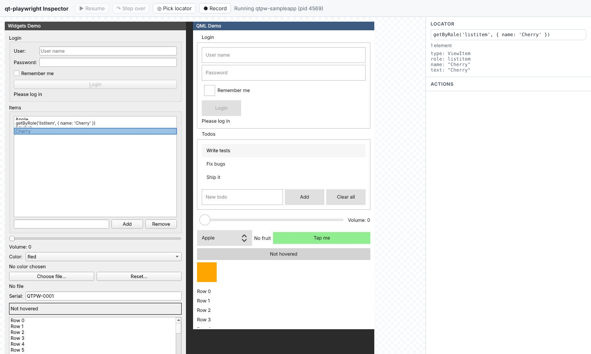
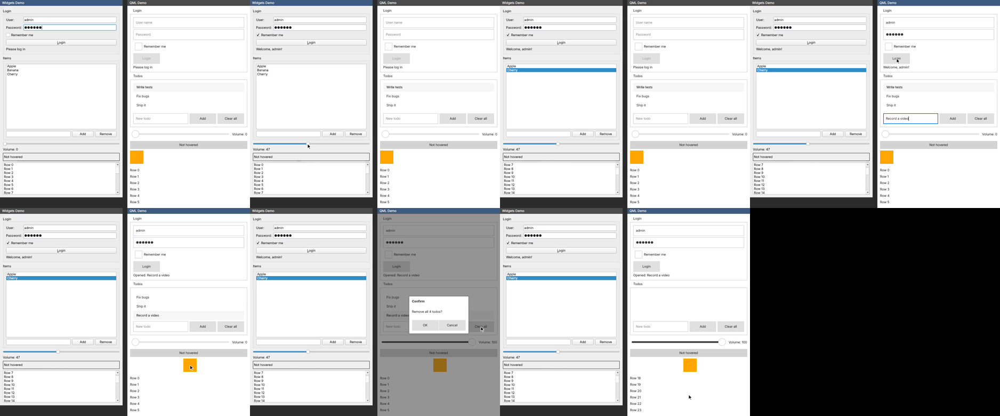

# qt-playwright: Playwright-style end-to-end tests for Qt apps

`qt-playwright` drives Qt applications (QtWidgets and Qt Quick/QML) from TypeScript tests
in the style of [Playwright](https://playwright.dev): lazy locators, auto-waiting
actions, retrying assertions and `@playwright/test` fixtures. Under the hood it uses
**GammaRay**: the GammaRay launcher injects the probe into the application, and a new
probe plugin (`gammaray_automation`) serves a JSON-RPC API over WebSocket from inside
the process.

```text
 test (Node)                            application process
 ┌───────────────────────┐   ws://     ┌───────────────────────────────────────────┐
 │ qt-playwright         │◄──────────► │ GammaRay probe                            │
 │  launch()/attach()    │  JSON-RPC   │  └ gammaray_automation plugin             │
 │  Locator, expect()    │             │      selector engine, handles, input,     │
 └──────────┬────────────┘             │      signals, screenshots (GUI thread)    │
            │ spawns                   └───────────────────────────────────────────┘
            ▼                                   ▲ LD_PRELOAD / gdb / ...
   gammaray --inject-only ... ./app ────────────┘
```



*A session recorded with `app.startVideo('demo.gif')`. The script is
`examples/scripts/record-demo.mjs` (slowMo 250 ms).*

| Path | What |
|------|------|
| `plugins/automation/` | probe plugin (C++, built with GammaRay when Qt WebSockets is available) |
| `automation/client/` | the `qt-playwright` npm package (TypeScript) |
| `automation/examples/sampleapp/` | sample app with a Widgets and a QML window (login form, list, dialog...) |
| `automation/examples/tests/` | example suite exercising every API feature |
| `automation/run-e2e.sh` | builds everything and runs the suite headless |
| `ARCHITECTURE_NOTES.md`, `DECISIONS.md` | design background |
| `PLAYWRIGHT_COMPARISON.md` | what matches Playwright's API, what differs, what is missing or extra |

## Setup

Requirements: Qt ≥ 6.5 **with the Qt WebSockets module** (GammaRay 3.x is Qt 6 only),
CMake, a C++17 compiler, Node.js ≥ 18. `ffmpeg` is only needed for video recording.
On Linux, `gdb` is only needed to attach to already running processes.

1. **Build GammaRay** as usual. If Qt WebSockets is found, the automation plugin is
   built automatically (`-- WARNING: Skipping the automation plugin ...` otherwise):

   ```sh
   cmake -S . -B build -G Ninja -DCMAKE_PREFIX_PATH=/path/to/Qt/6.8.3/gcc_64
   cmake --build build            # optionally: cmake --install build
   ```

2. **Install the client** into your test project. It is not published to npm yet, so
   install it from a checkout:

   ```sh
   cd automation/client && npm ci            # also builds dist/
   cd my-tests && npm install -D @playwright/test /path/to/GammaRay/automation/client
   ```

   Use `install-links=true` in your project's `.npmrc` (as `automation/examples` does).
   This copies the package instead of symlinking it, so it shares your
   `@playwright/test` instead of loading a second one.

3. **Point it at the launcher**: put `gammaray` on the `PATH`, or set
   `QT_PLAYWRIGHT_GAMMARAY=/path/to/build/bin/gammaray` (or pass `gammaray:` in the
   launch options).

To run the bundled example suite in one go (headless):

```sh
QT_PREFIX=/path/to/Qt/6.8.3/gcc_64 automation/run-e2e.sh
```

### Headless / CI

With no `DISPLAY` or `WAYLAND_DISPLAY`, or with `headless: true`, `launch()` sets
`QT_QPA_PLATFORM=offscreen` and `QT_QUICK_BACKEND=software` for both the GammaRay
launcher (itself a Qt GUI application) and the app. No X server or GPU is needed, and
screenshots still work. See `.github/workflows/automation.yml` for a complete CI job.

## A complete example

`playwright.config.ts`:

```ts
import { defineConfig } from '@playwright/test';
import type { QtOptions } from 'qt-playwright/test';

export default defineConfig<QtOptions>({
  testDir: './tests',
  fullyParallel: true, // every test gets its own app instance and port
  use: {
    qtApp: { executable: './build/myapp', args: [], env: { MYAPP_CONFIG: 'test' } },
    qtScreenshot: 'only-on-failure', // window screenshots attached to failed tests
    actionTimeout: 5_000, // default timeout for actions and assertions
  },
});
```

`tests/login.spec.ts`:

```ts
import { expect, test } from 'qt-playwright/test';

test('user can log in', async ({ app }) => {
  const window = app.locator('#loginWindow'); // objectName or QML id
  const login = window.locator('Button#loginButton'); // QML type + id

  await expect(login).toBeDisabled();
  await window.locator('#username').fill('admin'); // real key events
  await window.locator('#password').fill('secret');
  await expect(login).toBeEnabled(); // retried until true or timeout

  const loggedIn = await window.spy('loggedIn'); // record a signal
  await login.click(); // waits: visible, enabled, stable, not covered

  await expect(window.locator('#status')).toHaveText('Welcome, admin!');
  await expect(loggedIn).toHaveBeenEmittedWith(['admin']);
  await expect(window).toHaveProperty('loginAttempts', 1);

  // a modal dialog runs a nested event loop; the app stays scriptable
  await window.getByText('Delete account').click();
  const dialog = app.locator('#confirmDialog');
  await expect(dialog).toBeVisible();
  await dialog.getByText('Cancel').click();
  await expect(dialog).toBeHidden();
});
```

Run it with `npx playwright test`. The `app` fixture launches the application under
GammaRay for each test and terminates it afterwards. When a test fails, a screenshot
of every window and the app's stdout/stderr are attached to the report.

Without the test runner (e.g. with Vitest or a plain script):

```ts
import { expect, launch } from 'qt-playwright';

const app = await launch('./build/myapp', ['--some-flag']);
try {
  await app.locator('#okButton').click();
  await expect(app.locator('#status')).toHaveText('Done');
} finally {
  await app.close();
}
```

## Selectors

Selectors are matched against the combined tree of `QObject` children and the Qt Quick
**visual** tree (`QQuickItem::childItems()`, `QQuickWindow::contentItem()`, popup
contents). Results are in document order.

| Selector | Matches |
|----------|---------|
| `#okButton` | `objectName` **or** QML `id` |
| `QPushButton`, `QAbstractButton` | C++ class, including base classes |
| `Button`, `TextField`, `Item`, `Main` | QML type: Qt Quick classes without the `QQuick` prefix, QML-defined types by name |
| `*` | anything |
| `text="Save"` | text equals "Save" (case-sensitive, whitespace-normalized, `&` mnemonics ignored) |
| `text="save"i`, `text=save` | text contains "save", case-insensitive |
| `text=/^Sa.e$/i` | regular expression (flags `i`, `s`, `m`) |
| `role=button[name="Save"i]` | accessibility role (ARIA names from Qt's accessibility) and accessible name, also `[checked=true]`, `[disabled]`, `[expanded]`, `[selected]`, `[pressed]`, `[level=2]`, `[include-hidden]` — what `getByRole` uses |
| `label="User:"` | inputs by their label / accessible name — what `getByLabel` uses |
| `[checked=true]`, `[echoMode=Password]` | property equals (enums by key name, numbers numerically) |
| `[text!="x"]`, `[text*="Rem"]`, `[text=/re/]` | not-equals, contains, regex |
| `[checked]` | property is truthy |
| `A >> B` | `B` among the descendants of matches of `A` |
| `nth=1`, `nth=-1`, `first`, `last` | pick one of the matches so far |
| `visible=true` / `visible=false` | keep only (in)visible matches |
| `hasText="x"i`, `hasNotText=/re/` | keep matches whose own or descendants' text matches (or not) — `filter({ hasText })` |
| `has="sel"`, `hasNot="sel"` | keep matches with (without) a descendant matching `sel` — `filter({ has })` |
| `and="sel"`, `or="sel"` | intersection with / union with (document order) another selector — `and()`, `or()` |
| `handle=12` | the element with this handle (used internally for dialogs and file choosers) |

Segments combine: `#loginBox >> QLineEdit[echoMode=Password]`,
`QPushButton#ok[enabled=true]`. Quote values containing `]` or starting with `/`.
"Text" is the first of the `text`, `plainText`, `currentText` and `title` properties
that exists (the window title for top-level widgets). A control's own text wins over
the internal items that render it, so `text="OK"` finds the Button, not its Label
child.

**Strict mode:** actions and single-element queries throw `StrictModeViolationError`
when a locator matches more than one element. The message lists the matches. Use a
more specific selector, scope with `>>`, or use `.first()`, `.last()` or `.nth(i)`.

## API overview

### Launching and connecting

| | |
|-|-|
| `launch(app, args?, options?)` | start under `gammaray --inject-only` with the automation server enabled; options: `env`, `cwd`, `headless`, `gammaray`, `timeout`, `probeAbi`, `injector`, `automationPort`, `disabledPlugins`, `printOutput`, `defaultTimeout`, `slowMo`, `recordVideo` |
| `attach("host:port" \| "ws://...")` | connect to a running automation server, e.g. on a remote/embedded device |
| `attach(pid)` | inject the probe into a running process (gdb/lldb) and enable automation in it |
| `app.close()` | disconnect; for launched apps also terminate them |
| `app.locator(sel)`, `app.getByRole/Label/Placeholder/Title/TestId/Text(...)`, `app.getById(id)` | locators |
| `app.windows()`, `app.screenshot({ allWindows })`, `app.screenshotAllWindows()`, `app.ariaSnapshot()` | windows |
| `app.mouse`, `app.keyboard`, `app.touchscreen`, `app.press(key)`, `app.type(text)` | coordinate-level input (screen coordinates) |
| `app.evaluate(fn, arg)` | run JavaScript in the app (`qApp` is the application object) |
| `app.waitForEvent('dialog' \| 'filechooser' \| 'objectcreated' \| 'close')`, `app.on('dialog' \| 'close')`, `app.waitForDialog()`, `app.waitForFileChooser()` | events |
| `app.waitForObject(sel)`, `app.onObjectCreated(cb)`, `app.onObjectDestroyed(cb)` | object lifecycle events |
| `app.video()`, `app.startVideo(path, options)` | session video recording (see below) |
| `app.tracing.start()/stop({ path })`, `app.startCodegen()` | tracing (Playwright's trace.zip), codegen |
| `app.pause()`, `app.inspector()`, `app.hideHighlight()` | debugging: the inspector, highlights |
| `app.setDefaultTimeout(ms)`, `app.expectTimeout`, `app.slowMo`, `app.setTestIdAttribute(prop)`, `app.pid`, `app.info`, `app.output()` | misc |

Remote or embedded targets: start the app on the device with
`GAMMARAY_AUTOMATION_PORT=<port> GAMMARAY_AUTOMATION_ADDRESS=0.0.0.0 gammaray --inject-only ./app`
(or set the variables and preload the probe yourself), then `attach("device:<port>")`.

### Locators

All actions **auto-wait** until the element exists, is unique, is visible, is enabled
(where it matters) and is stable. Pointer actions also wait until the element receives
pointer events, i.e. it is not blocked by a modal window or popup, covered by another
widget, or clipped away. Before pointer actions, enclosing Flickables, ListViews and
QScrollAreas are scrolled to reveal the element. Pass `force: true` to skip the checks
and `timeout` to override the default.

| Actions | Queries | Composition |
|-|-|-|
| `click({button, modifiers, position, clickCount, delay, trial})` | `getProperty(name)`, `getProperties()` | `locator(sel, { hasText, has })` |
| `dblclick()`, `hover()`, `tap()` | `setProperty(name, value)` | `getByRole(role, { name, exact, checked, ... })` |
| `fill(text)`, `clear()`, `selectText()` | `invoke(method, ...args)`, `dispatchEvent(signalOrSlot)` | `getByLabel`, `getByPlaceholder`, `getByTitle`, `getByTestId`, `getByText` |
| `pressSequentially(text, { delay })` / `type(text)` | `evaluate(fn, arg)`, `evaluateAll(fn, arg)` | `filter({ hasText, hasNotText, has, hasNot, visible })` |
| `press("Control+A")` | `textContent()`, `inputValue()` | `and(other)`, `or(other)` |
| `check()`, `uncheck()`, `setChecked(b)` | `isVisible()`, `isHidden()`, `isEnabled()`, `isChecked()` | `first()`, `last()`, `nth(i)`, `visible()` |
| `selectOption(labelOrValue \| { label, value, index } \| [...])` | `boundingBox()`, `describe()`, `ariaSnapshot()` | `count()`, `all()`, `elements()`, `handle()` |
| `setInputFiles(files)` (button opening a file dialog) | `screenshot({ path, window, mask, caret })` | `describe(description)` |
| `scroll({deltaX, deltaY})` (120 = one wheel notch) | `waitFor({ state })` | |
| `dragTo(locator)`, `dragBy(dx, dy)` | `waitForSignal(sig)`, `spy(sig)` | |
| `focus()`, `blur()`, `scrollIntoViewIfNeeded()` | `selectedValues()`, `computedStyle()` | |
| `highlight()` | | |

Input is real input. Events go through QtGui's window system interface, the same path
as platform input and QTest. Hit testing, modality, focus changes, enter/leave, hover
handlers, double-click detection and drag thresholds behave as for a user. Keys use
Playwright names: `Enter`, `Tab`, `Escape`, `Backspace`, `Delete`, `ArrowUp`, `Home`,
`PageDown`, `F1`–`F35`, `Space`, single characters, with `Shift+`, `Control+`, `Alt+`,
`Meta+` (`ControlOrMeta+` maps to `Control`, which is Cmd on macOS).

Property values are converted to JSON: enums become key names, colors become
`"#rrggbb"`, `QPoint`/`QSize`/`QRect` become `{x, y, width, height}`, `QObject*` becomes
`{handle, type, ...}`. Writing accepts the same forms. `invoke` works for slots,
`Q_INVOKABLE`s and QML functions; pass `{ handle }` for QObject arguments.

### Signals

```ts
const spy = await window.spy('loggedIn');                // or 'loggedIn(QString)'
await loginButton.click();
expect(await spy.wait()).toEqual(['admin']);             // next emission's arguments
await expect(spy).toHaveBeenEmittedTimes(1);

const [args] = await Promise.all([window.waitForSignal('loggedIn'), loginButton.click()]);
```

Requests reach the application in order, so a `waitForSignal` sent before an action is
armed before the action's input is delivered.

### Assertions

`expect(locator)` from `qt-playwright/test` (or `qt-playwright`) retries until the
assertion passes or the timeout expires (`expectTimeout`, else the default timeout).
All assertions support `.not`:

- state: `toBeVisible`, `toBeHidden`, `toBeEnabled`, `toBeDisabled`, `toBeEditable`,
  `toBeChecked({checked})`, `toBeAttached`, `toBeFocused`, `toBeEmpty`,
  `toBeInViewport({ ratio })`
- content: `toHaveText(str|re|array)`, `toContainText(str|re|array)`, `toHaveValue`,
  `toHaveValues(array)` (selected rows of an item view), `toHaveCount(n)`,
  `toHaveProperty(name, value)` (alias `toHaveJSProperty`), `toHaveAttribute(name, value?)`
  (a Qt property as text), `toHaveId` (objectName / QML id), `toHaveClass` (a C++/QML type)
- style: `toHaveCSS(name, value)`: `color` and `background-color` (from the palette, which
  style sheets feed, or QML colors; `"#c00000"`, `"red"` and `"rgb(192, 0, 0)"` all work),
  `font-size`, `font-weight`, `font-style`, `font-family`, `text-decoration-line`,
  `opacity`, `width`, `height`, `visibility`, `cursor`, and for QML Rectangles
  `border-color`, `border-width`, `border-radius`
- accessibility: `toHaveRole`, `toHaveAccessibleName`, `toHaveAccessibleDescription`,
  `toMatchAriaSnapshot(template)`
- pixels: `toHaveScreenshot(name?, { mask, maxDiffPixels, maxDiffPixelRatio, threshold })`
- the whole app, `expect(app)`: `toHaveTitle`, `toMatchAriaSnapshot`, `toHaveScreenshot`
- spies: `toHaveBeenEmitted`, `toHaveBeenEmittedTimes(n)`, `toHaveBeenEmittedWith(args)`

The `expect` exported by `qt-playwright/test` passes any other value to Playwright's
own `expect`. The one from `qt-playwright` only accepts Locators, spies and apps.

### Accessibility: roles, labels and ARIA snapshots

`getByRole` and `getByLabel` use Qt's accessibility interfaces (activated on first
use, which Qt Quick controls need). Qt roles are reported with ARIA names: `button`,
`checkbox`, `radio`, `textbox`, `combobox`, `slider`, `spinbutton`, `list`,
`listitem`, `tab`, `menuitem`, `dialog`, `group`, `text` for static text, and so on.
Names come from labels (QFormLayout/buddy labels for widgets), `Accessible.name`, or
the control's text, falling back to the placeholder.

```ts
await app.getByLabel('User:').fill('admin');
await app.getByRole('button', { name: 'Login' }).click();
await expect(app.locator('#loginBox')).toMatchAriaSnapshot(`
  - group "Login":
    - textbox "User:": admin
    - checkbox "Remember me" [checked]
    - button "Login"
`);
```

Templates match partially, as in Playwright: listed nodes must appear in order, and
other nodes may be in between. Names accept `/regex/`. `locator.ariaSnapshot()` and
`app.ariaSnapshot()` produce such YAML from the live UI.

### Running JavaScript in the application

`evaluate` runs a function inside the application with Qt's JavaScript engine. QML
elements use their own QML engine. Other objects use a private `QJSEngine`, in which
`qApp` is the application object. Elements are passed as QObject wrappers, so their
properties, slots, `Q_INVOKABLE`s and signals are all reachable. The result comes back
as JSON, and QObjects come back as element references.

```ts
await app.locator('#todoList').evaluate((list) => list.positionViewAtEnd());
const titles = await app.locator('ItemDelegate').evaluateAll((items) => items.map((i) => i.text));
await app.locator('#username').evaluate((edit, text) => { edit.text = text; }, 'admin');
const name = await app.evaluate(() => qApp.applicationName);
```

### Dialogs and file choosers

Qt dialogs are ordinary windows (QDialog, QMessageBox, QFileDialog) or Qt Quick
popups, so locators work on them directly. The Playwright-style helpers find them for
you:

```ts
const dialogPromise = app.waitForEvent('dialog');
await app.getByRole('button', { name: 'Reset...' }).click();
const dialog = await dialogPromise;
expect(await dialog.message()).toBe('Reset the login form?');
await dialog.accept(); // Enter for widget dialogs (default button), accept() for Qt Quick

app.on('dialog', (d) => d.dismiss()); // handle every dialog shown from now on

await app.getByRole('button', { name: 'Choose file...' }).setInputFiles('data/input.csv');
```

`setInputFiles` clicks the element, waits for the file dialog, types the path into its
file name field and presses Enter. Use `waitForEvent('filechooser')` to drive it
yourself.

### Mouse, keyboard and touch

`app.mouse`, `app.keyboard` and `app.touchscreen` work in screen coordinates, the same
coordinates as `boundingBox()`:

```ts
const box = (await slider.boundingBox())!;
await app.mouse.move(box.x + 4, box.y + box.height / 2);
await app.mouse.down();
await app.mouse.move(box.x + box.width, box.y + box.height / 2, { steps: 10 });
await app.mouse.up();
await app.keyboard.down('Shift'); // held modifiers apply to later keys and clicks
await app.keyboard.press('Home');
await app.keyboard.up('Shift');
await app.keyboard.insertText('ü€'); // input method commit, no key events
await app.touchscreen.tap(box.x + 10, box.y + 10); // a real touch screen device
```

### Screenshot assertions

`expect(locator).toHaveScreenshot()` waits until two consecutive screenshots are
identical, then compares against a baseline stored next to the test. It uses
Playwright's snapshot machinery: `--update-snapshots`, per-project snapshot
directories, and `maxDiffPixels` / `maxDiffPixelRatio` / `threshold`. The text cursor
is held steady, and `mask` paints over volatile elements. Font rendering differs
between machines, so keep baselines per platform (Playwright adds the platform suffix)
or limit them to font-free elements.

### Item views: rows as elements

Rows of `QListView`, `QTreeView` and `QTableView` (and the widget variants) are
elements, although Qt has no QObjects for them: list rows have the role `listitem`, tree
rows `treeitem` (children of their parent row while it is expanded, with a `level`),
and table rows `row` with `cell` children. A row is named after its text (a table row
after its cells), so:

```ts
await app.getByRole('treeitem', { name: 'Documents' }).dblclick();
await app.getByRole('treeitem', { name: 'report.pdf' }).check();   // the row's check box
const row = app.locator('#peopleTable').getByRole('row').filter({ hasText: 'Carol' });
await expect(row.getByRole('cell')).toHaveText(['Carol', '45', 'Oslo']);
await app.locator('#tagList').selectOption(['green', 'blue']);       // Ctrl+click
await expect(app.locator('#tagList')).toHaveValues(['green', 'blue']);
```

Rows scrolled out of view are scrolled into view (`QAbstractItemView::scrollTo`) before
pointer actions. Rows have the properties `text`, `row`, `column`, `selected`,
`current`, `checkable`, `checked`, `expanded` (writable), `editable`, `toolTip` and
`cells`, and appear in ARIA snapshots and codegen. `fill()` on an editable row or cell
opens the view's editor, types the text and commits it with Enter.

### Tracing

```ts
await app.tracing.start({ title: 'checkout' });
// ... actions ...
await app.tracing.stop({ path: 'trace.zip' });
```

```sh
npx playwright show-trace trace.zip
```

Traces use Playwright's own format, so Playwright's trace viewer opens them, as does
trace.playwright.dev and the HTML report. Every API call is an action with its locator,
timing, call log (what auto-waiting waited for) and error. There is a film strip of all
windows, the application's output, and snapshots before, during and after each action,
showing the target and the click point. Qt has no DOM, so a snapshot is a screenshot
with the element tree laid over it: transparent elements carrying the ARIA role,
accessible name, `data-testid` (the objectName) and text. The viewer's "Pick locator"
therefore suggests `getByRole()`, `getByTestId()` and `getByText()` locators that work
in qt-playwright. With the fixture, Playwright's `trace` option (or `qtTrace`) records
traces and attaches them to the report: `'on'`, `'retain-on-failure'`,
`'on-first-retry'`, `'on-all-retries'` or `'retain-on-first-failure'`. A `.html` path
(or `qtTrace: { mode, format: 'html' }`) writes a self-contained HTML viewer instead.



### Inspector and debugging

`app.pause()` opens the inspector, Playwright's Inspector adapted to Qt. It is a local
web page (127.0.0.1 only, with a random token in the URL) that offers:

- a live view of all windows;
- **Pick locator**: click an element to get the locator codegen would use;
- a **locator playground**: type `getByRole('button', { name: 'Login' })` to see how many
  elements match, highlighted in the view and inside the application;
- **Resume** (F8) and **Step over** (F10);
- the test's actions, and **Record**, which generates code from what you do.

`QTPW_DEBUG=1 npx playwright test` works like `PWDEBUG=1`: no timeouts, and the
inspector pauses before every action, with the target highlighted in the application.
`npx qt-playwright inspect ./build/myapp` opens the inspector for an application
without a test. `locator.highlight()` draws the same highlight from a test (it also
shows in screenshots and videos) until `app.hideHighlight()`. To look at the object
tree, properties and signals in depth, connect the GammaRay client
(`gammaray --connect`) to the paused application.



### Codegen

```sh
npx qt-playwright codegen ./build/myapp [args...] > tests/recorded.spec.ts
```

`codegen` launches the application and records what you do as a qt-playwright test.
It records clicks, double clicks, typing (one `fill` per field), key presses,
check/uncheck, combo box selections and drags. Locators follow Playwright's preference
order: role + name, label, placeholder, test id (objectName), QML id, text, then type.
Each locator is made unique by scoping to the window or adding `.nth()` when needed:

```ts
await app.getByRole('textbox', { name: 'User:' }).fill('admin');
await app.getByTestId('loginButton').click();
await app.getByRole('combobox', { name: 'Color:' }).selectOption('Green');
await app.locator('#qmlWindow').getByRole('button', { name: 'Add' }).click();
```

`app.startCodegen()` does the same from code. It records API-driven input too, which
is how the recorder itself is tested: the generated code is replayed on a fresh
instance. `app.pause()` stops a test until you press Enter, so you can inspect the
running app, for example with the GammaRay client (`gammaray --connect`).

## Video recording

All visible top-level windows of the application are recorded into one video. Windows
appear at their screen positions with a title bar each (offscreen windows have no
decorations), and the synthesized mouse pointer is drawn on top, highlighted while a
button is pressed. The application sends a frame only when the picture changes. The
client repeats frames according to their timestamps, so the video plays back in real
time, and pipes them into `ffmpeg`. The file extension picks the format: `.mp4`
(H.264, default), `.webm` (VP8), `.mkv`, `.mov` or `.gif`. Set `QT_PLAYWRIGHT_FFMPEG`
or the `ffmpeg` option if it isn't on the `PATH`.

```ts
// like Playwright's recordVideo: one file per launched app, finished when it closes
const app = await launch('./myapp', [], {
  recordVideo: { dir: 'videos', size: { width: 1280, height: 720 } },
});
// ... test ...
await app.close();
console.log(await app.video()!.path());

// or on demand, for part of a session
const video = await app.startVideo('out/checkout.mp4', { fps: 25, scale: 0.5 });
// ...
await video.stop();
```

With the test fixture, use Playwright's own option (or `qtVideo`, which takes precedence):

```ts
use: { video: 'retain-on-failure' } // 'on' | 'off' | 'retain-on-failure' | 'on-first-retry'
```

The mp4 is attached to the test and playable in the HTML report. `slowMo` (launch
option or `qtApp.slowMo`) slows every action down for watchable recordings.



Notes: the canvas is fixed when recording starts (the union of the windows visible
then), so windows that open later outside of it are clipped. Use `size` to fit large
desktops into a fixed resolution. Frames are taken with `QWidget::grab()` and
`QQuickWindow::grabWindow()` at up to `fps` per second on the GUI thread. This costs
a few milliseconds per frame for typical windows, so lower `fps` or `scale` for heavy
UIs. Frames are dropped, not buffered, if the client can't keep up.

## Protocol

The plugin speaks JSON-RPC 2.0 over WebSocket. Any language can drive it. It is
**opt-in**: it only listens if `GAMMARAY_AUTOMATION_PORT` (or the probe setting
`AutomationPort`, e.g. `gammaray --probe-setting AutomationPort=0`) is set; `0` picks a
free port. It binds to `127.0.0.1` unless `GAMMARAY_AUTOMATION_ADDRESS` says otherwise.
When ready it prints `GammaRay automation server listening on ws://...` and writes
`$TMPDIR/gammaray-automation-<pid>.json` (or `$GAMMARAY_AUTOMATION_PORT_FILE`).

Methods: `hello`, `query {selector, scope?, describe?}`, `windows`, `describe`,
`actionability`, `scrollIntoView`, `getProperty`, `getProperties`, `setProperty`,
`invokeMethod`, `isVisible`, `isEnabled`, `text`, `geometry`, `focus`, `click`,
`doubleClick`, `hover`, `type`, `fill`, `press`, `scroll`, `drag`, `sync`,
`screenshot`, `waitForSignal`, `spy`, `spyEvents`, `unspy`, `subscribe`,
`startRecording`, `stopRecording`, `evaluate`, `ariaSnapshot`, `screenshotAll`,
`blur`, `tap`, `selectOption`, `mouseMove`, `mouseDown`, `mouseUp`, `mouseWheel`,
`keyDown`, `keyUp`, `insertText`, `startCodegen`, `stopCodegen`. Notifications:
`objectsCreated {elements}`, `objectsDestroyed {handles}`, `codegenAction`. Video
frames are binary messages: `"QTPW"`, a format
byte, 3 bytes of padding, uint32 recording id, float64 milliseconds, then the JPEG/PNG
data, little endian. Elements are referred to by
stable integer **handles**, which are never reused. A handle to a destroyed object
fails with error `1001` (stale). See `plugins/automation/automation.cpp` for the
parameters.

Everything runs on the GUI thread. Input actions run as small steps from a zero-timer
and reply before the final event (for example the mouse release). An action that opens
a modal dialog (`QDialog::exec()`) or starts a drag therefore doesn't block the API:
later requests are served from the nested event loop.

## Limitations

- **Model/view rows** are elements for `QListView`, `QTreeView` and `QTableView`
  (and subclasses), up to 5000 rows per parent. `QColumnView` and custom
  `QAbstractItemView`s expose rows like a list. QML delegates are items and work
  normally, but only once instantiated (off-screen ListView delegates may not exist
  yet).
- **Text** is an element's own text property, not the concatenated text of its
  descendants as in the DOM.
- **QML type names** come from class names (`QQuickButton` gives `Button`,
  `LoginForm_QMLTYPE_3` gives `LoginForm`). Module-qualified names
  (`QtQuick.Controls/Button`) only work for C++-registered types, and only when
  GammaRay's qmlsupport plugin is loaded. Types are matched along the C++ class chain,
  so a QML component inherits matches from its C++ base (`Button` →
  `AbstractButton` → `Control` → `Item`), not from intermediate QML-defined bases.
- **Obstruction checks** detect modal windows, modal Qt Quick popups, overlapping
  widgets and clipping ancestors of Qt Quick items. A Qt Quick item covered by an
  unrelated sibling (for example a MouseArea on top) is not detected.
- **Not covered:** QGraphicsView items, Qt 3D, Qt WebEngine content, native platform
  dialogs and menus. QQuickWidget content is supported but less tested. Widget drag and
  drop through `QDrag` is untested.
- `invoke()` and `evaluate()` are synchronous: calling something that runs `exec()`
  only returns when the dialog closes. Click the button that opens it instead.
  `evaluate` runs in Qt's JavaScript engine (ECMAScript 2017+), which has no DOM, and
  returned promises are not awaited.
- **Accessibility** is activated in the application on the first role/label query.
  Qt Quick only keeps accessible names and states up to date while a screen reader
  bridge is connected, so qt-playwright falls back to `Accessible.*` properties, text,
  placeholders and `checked`/`pressed` properties. Roles and names can differ slightly
  from what a screen reader announces.
- **Codegen** doesn't record scrolling, hovering, or Qt Quick drags that a DragHandler
  handles by touch.
- **toHaveCSS** reports what Qt knows: colors come from the palette (style sheets set
  it when the widget is polished) or QML color properties, not from what the style
  paints. Style sheet properties without a palette or font equivalent (margins,
  borders of widgets, gradients) are only available as the raw `-qt-style-sheet` text.
- **Not available:** Playwright's network interception, clock control, browser
  contexts and storage state (no Qt equivalent), and UI mode. Trace snapshots are
  pictures with an element overlay, not live DOM: the viewer's DOM tools beyond
  locator picking (CSS, console evaluation) do not apply.
- **Platforms:** developed and tested on Linux with Qt 6.8 and the offscreen platform.
  Launching should work wherever GammaRay injection works (Windows `windll`, macOS
  preload) but is untested. Attaching by pid needs gdb or lldb and ptrace permission.
- **Qt 5 is not supported**, because GammaRay 3.x itself requires Qt ≥ 6.5. The
  client and protocol are Qt-version agnostic.
- **Security:** the automation server is unauthenticated and can fully control the
  application. It is opt-in and binds to localhost by default. Only expose it (with
  `GAMMARAY_AUTOMATION_ADDRESS`) on trusted networks.
- Synthetic input coexists with real input: on a real desktop, moving the physical
  mouse during a test can interfere.
